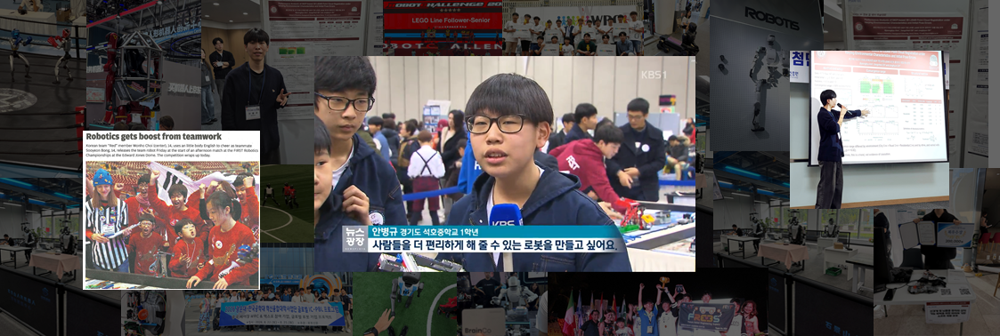

  

  

## Byeongkyu Ann | 안병규
🎓 **B.S. Student in Robotics, Kwangwoon University**

🔬 **Research Interests:** SLAM & Autonomous Navigation, Robotics & Control, Embedded AI Optimization, Assistive & Medical Robotics

⚙️ **Core Stack:** Python, C, ROS2, Embedded Systems

🎯 **Key Focus:** 3D LiDAR SLAM 및 자율주행 알고리즘을 비롯해, 제한된 환경에서 동작하는 효율적인 임베디드 AI와 실생활에 기여할 수 있는 로봇 시스템을 연구합니다.

 

  <b>📬 Contact me 📬</b>

 

  
  
  

 

🏛️ **Research Experience**
- Robotics & A.I. Laboratory, Department of Robotics, Kwangwoon University (April 2026 – Present)

 

📚 **Education**
- Kwangwoon University, B.S. in Robotics
- Bugil Academy (북일고등학교), Science track (March 2018 – February 2021)
  - Founder of ROBOTECH, Robotics Club at Bugil Academy

 

  
  
  
  

---

## 🛠️ Tech Stacks

  
  
  
  
  
  

